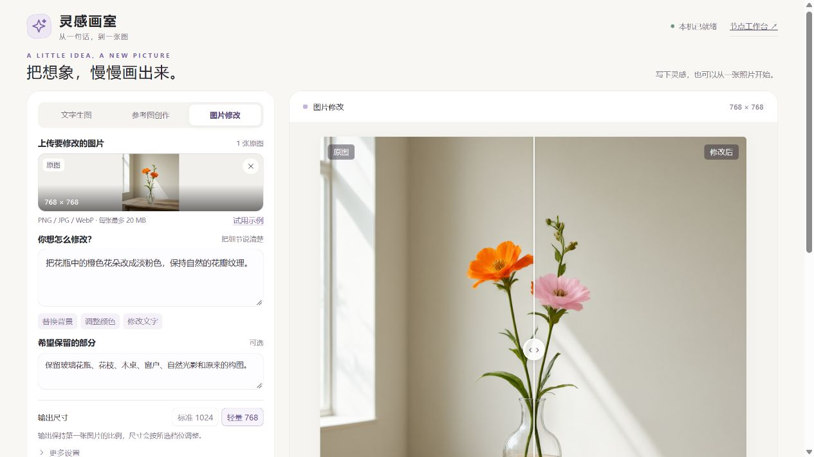

# 灵感画室 · Inspiration Studio

一个中文本地生图界面：写一句话，参考一两张图，或修改已有图片。

支持 **Qwen-Image-2.1-Turbo + ComfyUI**，独立非官方项目。画室只连接本机服务，无云端生图 API、账号或前端构建步骤。



图中为本地实测：把橙色花朵改成淡粉色，同时保留花瓶和主要构图。示例图片由模型生成，用于功能演示。

> GitHub 托管可复刻的源码。生成图片仍需要你自己的电脑、兼容的 GPU 和 ComfyUI；GitHub Pages 不能运行模型。

## 可以做什么

| 入口 | 输入 | 用途 |
| --- | --- | --- |
| 文字生图 | 画面描述 | 从零生成图片 |
| 参考图创作 | 1–2 张图片和描述 | 参考主体、色彩或场景组合创作 |
| 图片修改 | 原图、修改要求、保留要求 | 换颜色、换背景、改文字，并滑动对比原图 |

- 中文提示词示例、拖入上传、透明参考图支持。
- 768 / 1024 档位；参考图模式跟随第一张图的比例。
- 三种模式分别记住草稿、分辨率和种子。
- 真实任务状态、刷新恢复、历史作品、结果复用。
- 下载 PNG 和可编辑 ComfyUI 工作流；PNG 内也保留生成参数。
- 本机端口、路径可配置，代码不依赖作者电脑上的目录。

“保留要求”是模型指令，不是像素锁定；文字和细节仍需检查。当前没有涂抹蒙版编辑工具。

## 快速开始 · Windows

先准备 **Python 3.10+** 和支持 `TextEncodeQwenImage21` 的 ComfyUI。完整步骤见 [安装指南](docs/INSTALL.md)。

```powershell
git clone https://github.com/hellobigstar/inspiration-studio.git
cd inspiration-studio
.\setup.ps1 -ComfyUIDir "D:\AI\ComfyUI" -BackendUrl "http://127.0.0.1:8189"
```

`ComfyUIDir` 指向含 `main.py` 的 ComfyUI 目录。脚本只在本项目创建 `.venv`、安装 Pillow、生成 `config.json`，不会安装或替换 PyTorch、CUDA、ComfyUI，也不会自动下载模型。

如已装好三份模型，可以直接跳过下载。否则先阅读 [模型许可说明](docs/MODEL-LICENSE.md)，再运行：

```powershell
# 仅列出下载计划，不联网下载
.\.venv\Scripts\python.exe download_models.py
# 显式下载，共约 14.24 GB，支持断点续传和 SHA-256 校验
.\.venv\Scripts\python.exe download_models.py --download
```

先启动你自己的 ComfyUI（地址须与 `backend_url` 一致），再执行：

```powershell
.\.venv\Scripts\python.exe studio\server.py --check
.\start.cmd
```

浏览器打开 `http://127.0.0.1:8190`。关闭画室终端或按 `Ctrl+C` 可停止画室，ComfyUI 由你单独管理。

PowerShell 禁止脚本运行时，可按 [手动安装步骤](docs/INSTALL.md) 使用 Python 命令，无需改系统策略。

### Linux / macOS 或手动设置

适用于同机已有兼容 ComfyUI 的环境；本项目不承诺所有 GPU/平台都能运行这些量化权重。

```bash
python3 -m venv .venv
source .venv/bin/activate
python -m pip install -r requirements.txt
cp config.example.json config.json
# 编辑 config.json，填写你的 ComfyUI 路径和本机服务地址
python studio/server.py --check
python studio/server.py --open-browser
```

## 配置与模型

`config.json` 不进入 Git。相对目录按配置文件所在目录解析：

```json
{
  "comfyui_dir": "../ComfyUI",
  "backend_url": "http://127.0.0.1:8189",
  "port": 8190,
  "data_dir": "./data",
  "max_upload_mb": 20
}
```

可用 `--config path/to/config.json` 指定另一份配置，也可设置 `QWEN_STUDIO_CONFIG` 环境变量。画室与 ComfyUI 必须在同一台机器上；界面仅监听 `127.0.0.1`，不支持直接暴露到公网。

模型清单、精确大小和校验值见 [models.json](models.json)。使用官方 8 步 Turbo 采样配置；工作流内固定 `pytorch attention`，保留已验证的显卡兼容方案。模型权重不随仓库或 ZIP 分发。

## 验证基线

原本地实现已在 Windows 11、RTX 5080 Laptop 16 GB、32 GB 内存上实际完成文字生图、双参考图和改图。已验证组合为 ComfyUI 0.39.0（`8010b48d2c1be986613f8e8c761527d205bd756f`）及 PyTorch 2.11.0+cu128；这是一组实测配置，不是所有机器的最低要求或速度保证。

仓库测试不下载模型，也不占用 GPU：

公开版在独立 Python 3.12 / Pillow 12.2.0 环境中安装验证：21 项 Python 测试及前端行为测试通过；通过配置连接已有 ComfyUI，实际完成 768×768 参考图修改。详见 [验证记录](docs/VERIFICATION.md)。

```bash
python -m unittest discover -s tests -p "test_*.py" -v
node tests/frontend-smoke.cjs
```

Node 仅用于前端测试，运行画室不需要 Node。GitHub Actions 在 Windows/Linux、Python 3.10/3.12 上运行上述检查。

## 项目结构

```text
studio/              中文界面、HTTP 服务、配置与模型检查
workflows/           API 模板与可编辑 ComfyUI 模板
tests/               无 GPU 的行为测试
docs/                安装、模型许可与复现说明
models.json          官方模型下载清单和 SHA-256
download_models.py   显式下载、续传和校验
setup.ps1            Windows 环境初始化
start.cmd            Windows 启动画室
```

上传图片位于 ComfyUI 的 `input/qwen-studio`；生成图片位于 `output/QwenStudio`；任务记录位于配置的 `data_dir`。分享日志或问题截图前，请自行检查其中的图片、提示词和本机路径。

## 许可证

本项目原创界面、服务和脚本采用 [MIT](LICENSE)。**模型不是 MIT**：Qwen-Image-2.1-Turbo 采用 [Qwen Research License](https://huggingface.co/Qwen/Qwen-Image-2.1-Turbo/blob/main/LICENSE)，用于非商业研究和评估，商业使用需单独授权。ComfyUI、Pillow 和模型保留各自许可，详见 [NOTICE](NOTICE) 与 [模型许可说明](docs/MODEL-LICENSE.md)。

## English

Inspiration Studio is an independent Chinese-language local UI for Qwen-Image-2.1-Turbo through ComfyUI. It supports text-to-image, one/two reference images, instruction editing, before/after comparison, reusable results, and downloadable workflows. Run it alongside ComfyUI on the same computer. No model weights are bundled; the model's research license is separate from this project's MIT license. See [installation instructions](docs/INSTALL.md).
